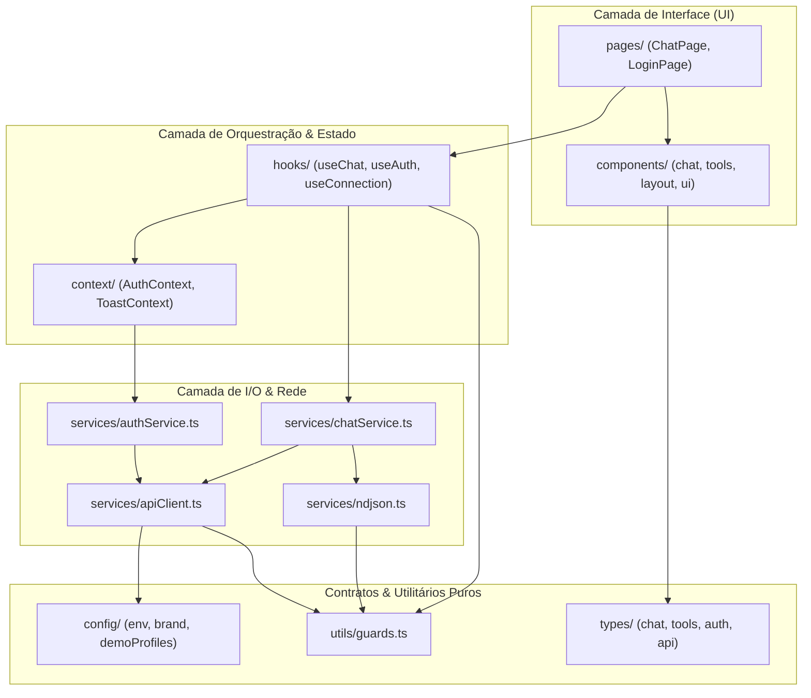
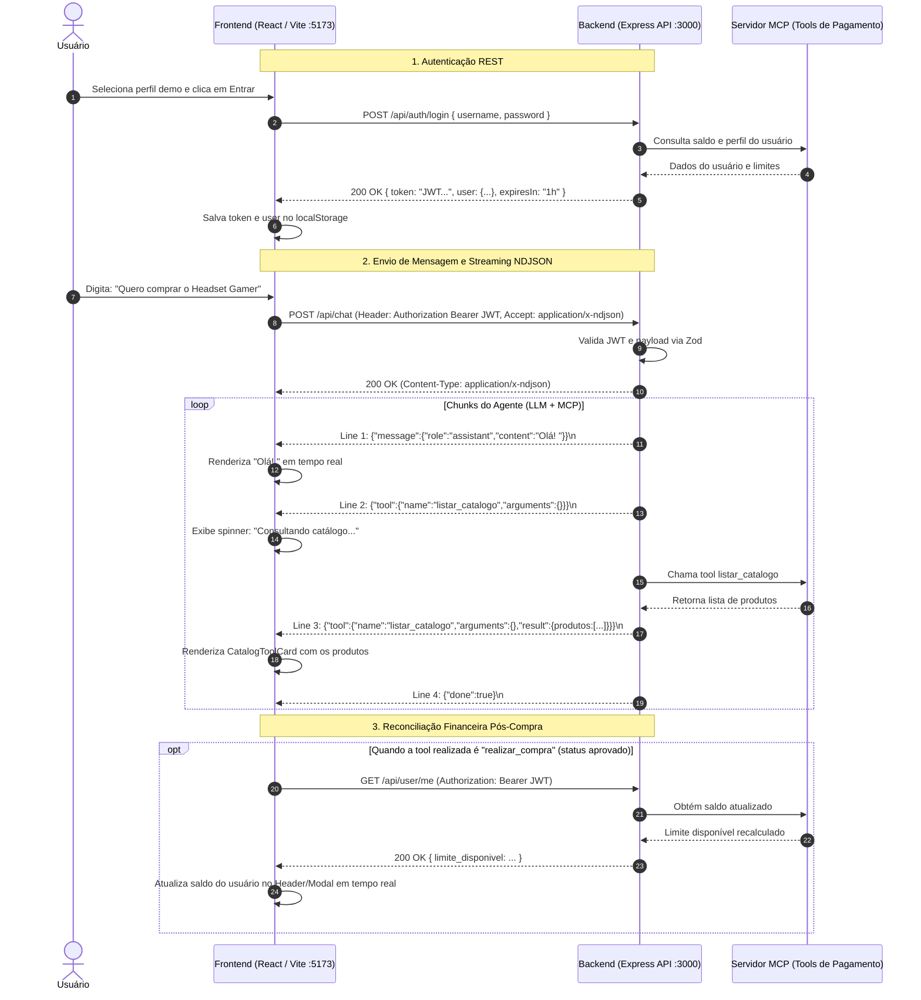

# Arquitetura do Frontend (React + TypeScript) e Integração com o Backend

Este documento descreve detalhadamente a arquitetura do frontend da aplicação **Nexus Store**, o papel e relacionamento de cada pasta no projeto, os padrões arquiteturais aplicados e o funcionamento ponta a ponta da comunicação em tempo real com o backend.

---

## 1. Visão Geral e Filosofia Arquitetural

O frontend foi desenvolvido com **React 19**, **TypeScript (modo estrito)** e **Vite 6**, priorizando alta performance, baixo consumo de memória e manutenibilidade sem dependências de infraestrutura desnecessárias.

### Princípios Chave da Implementação:
1. **Layered Architecture & Separation of Concerns (SoC):** As responsabilidades de rede (I/O), gerenciamento de estado global, lógica de apresentação de domínio e renderização visual estão rigidamente separadas em camadas.
2. **Headless / Custom Hooks Pattern:** Componentes visuais não manipulam diretamente streams ou chamadas de API. Toda a orquestração do chat, controle de streaming e concorrência reside em hooks customizados (`useChat`, `useAuth`, `useConnection`).
3. **Polymorphic UI por Discriminated Unions:** Eventos de ferramentas vindos do backend (MCP Tools) são mapeados em tempo de execução para componentes visuais específicos usando **Type Guards** TypeScript nativos.
4. **Zero-Overhead Runtime:** Não utiliza bibliotecas externas pesadas de validação no cliente (como Zod ou Yup), nem bibliotecas de estado global invasivas (como Redux ou MobX), nem frameworks de componentes CSS-in-JS. A estilização utiliza CSS nativo com variáveis semânticas (design tokens).
5. **Streaming HTTP First-Class:** O consumo de streaming é feito diretamente via Web Streams API (`fetch` + `ReadableStream` + `TextDecoder`) com parsing linha a linha de **NDJSON** (*Newline Delimited JSON*), sem recorrer a WebSockets ou bibliotecas proprietárias de SSE.

---

## 2. Estrutura de Diretórios (`frontend/src`)

A estrutura de código fonte está organizada da seguinte maneira:

```
frontend/src/
├── assets/             # Recursos estáticos importados pelo bundle (imagens SVG locais)
├── components/         # Componentes visuais subdivididos por responsabilidade
│   ├── chat/           # Interface do chat (janela, balões, compositor, indicadores)
│   ├── layout/         # Casca da aplicação (AppShell, Header)
│   ├── products/       # Componentes de exibição de produtos do e-commerce
│   ├── tools/          # Cards visuais polimórficos para eventos de Tools MCP
│   ├── ui/             # Primitivas reutilizáveis do Design System (Button, Modal, etc.)
│   └── user/           # Painel de perfil e exibição de saldos/limites
├── config/             # Configurações estáticas, variáveis de ambiente e perfis demo
├── context/            # Contextos React (estado global de Auth e Notificações/Toasts)
├── hooks/              # Custom hooks de domínio e lógica de estado
├── pages/              # Páginas e views de nível superior montadas pelas rotas
├── routes/             # Definição e proteção de rotas (ProtectedRoute)
├── services/           # Camada de comunicação com APIs externas e parsers de rede
├── styles/             # Folhas de estilo modulares e variáveis CSS globais
├── types/              # Contratos e tipos estritos do TypeScript
└── utils/              # Funções utilitárias puras e Type Guards em tempo de execução
```

### Detalhamento Pasta por Pasta

| Diretório | Papel Principal | Arquivos Chave | O que NÃO deve conter |
|---|---|---|---|
| `config/` | Centraliza variáveis globais, URLs e dados estáticos de teste. | `env.ts`, `brand.ts`, `demoProfiles.ts` | Lógica de negócio, hooks ou chamadas de rede. |
| `types/` | Contratos estritos de dados (APIs, Tools MCP, Chat, Auth). | `api.ts`, `auth.ts`, `chat.ts`, `tools.ts` | Implementações de código ou JSX/TSX. |
| `utils/` | Funções puras: formatação monetária, datas, IDs e Type Guards. | `guards.ts`, `currency.ts`, `date.ts`, `id.ts` | Estados de React ou dependências de contexto. |
| `services/` | I/O e comunicação de rede. Consome `fetch`, processa streams NDJSON. | `apiClient.ts`, `chatService.ts`, `ndjson.ts`, `authService.ts`, `healthService.ts` | Hooks de React, JSX, referências a DOM (exceto Eventos Globais). |
| `context/` | Estado global da aplicação com listeners e sincronização de abas. | `AuthContext.tsx`, `auth.ts`, `ToastContext.tsx`, `toast.ts` | Componentes de tela completos ou lógica de renderização direta. |
| `hooks/` | Orquestração da lógica de negócio e estados do chat. | `useChat.ts`, `useAuth.ts`, `useConnection.ts` | Tags JSX ou layouts visuais diretos. |
| `routes/` | Controle de acesso a rotas privadas via React Router 7. | `ProtectedRoute.tsx` | Chamadas de API diretas sem passar por hooks. |
| `components/ui/` | Primitivas atômicas do Design System (botões, inputs, modais). | `Button.tsx`, `Input.tsx`, `Modal.tsx`, `Spinner.tsx`, `Badge.tsx` | Conhecimento sobre o domínio de compras ou regras de negócio. |
| `components/chat/` | Componentes que formam a experiência interativa de conversação. | `ChatWindow.tsx`, `ChatComposer.tsx`, `MessageBubble.tsx`, `TypingIndicator.tsx` | Requisições HTTP diretas (recebem callbacks via props). |
| `components/tools/` | Renderizadores especializados de payloads de ferramentas MCP. | `ToolEventCard.tsx`, `CatalogToolCard.tsx`, `PurchaseIntentCard.tsx`, `PurchaseReceiptCard.tsx` | Controle de autenticação ou de rota. |
| `components/products/` | Exibição de cards de produtos da loja. | `ProductCard.tsx`, `ProductGrid.tsx` | Lógica de streaming. |
| `components/layout/` | Esqueleto visual estrutural que envolve as páginas. | `AppShell.tsx`, `Header.tsx` | Estados complexos de conversação. |
| `pages/` | Pontos de entrada das rotas. Amarram hooks com os componentes visuais. | `ChatPage.tsx`, `LoginPage.tsx`, `NotFoundPage.tsx` | Implementação de lógica de baixo nível de sockets/streams. |
| `styles/` | CSS puro desacoplado, organizado por contexto e tokens de design. | `variables.css`, `global.css`, `chat.css`, `components.css`, `login.css` | Dependências de bibliotecas externas (Tailwind, Sass). |

---

## 3. Grafo de Relacionamentos e Fluxo Unidirecional de Dados

A arquitetura respeita estritamente o fluxo unidirecional: dependências apontam para camadas mais internas ou agnósticas.



### Ciclo de Interação Típico:
1. O usuário digita uma mensagem no `ChatComposer` e envia.
2. `ChatPage` invoca a função `sendMessage` fornecida pelo hook `useChat`.
3. `useChat` cria a mensagem do usuário, cria uma mensagem vazia para o assistente e invoca `sendChatMessage` (`services/chatService.ts`).
4. `chatService` envia requisição HTTP POST para `/api/chat` com o token JWT e aciona `consumeNdjson` (`services/ndjson.ts`) passando o `ReadableStream`.
5. À medida que chunks chegam pela rede, `consumeNdjson` valida e decodifica cada linha, emitindo eventos de volta para o `useChat` via callback `onEvent`.
6. O `useChat` atualiza o estado React de forma reativa:
   - Se for token de texto: concatena ao conteúdo da mensagem do assistente.
   - Se for evento de tool pendente: exibe indicador de atividade.
   - Se for evento de tool concluído: cria uma mensagem de tool no histórico.
   - Se a tool for `realizar_compra` aprovada: dispara `refreshUser()` via `useAuth` para sincronizar os saldos bancários em tela.

---

## 4. O Core da Implementação do Chat e Streaming

A implementação do chat se apoia em 3 pilares principais:

### 4.1. O Custom Hook `useChat` (`frontend/src/hooks/useChat.ts`)
É o centro nervoso da aplicação. Ele encapsula:
- **Histórico Reconciliado de Mensagens:** Mantém o estado `messages` (para acionar re-renderizações) em paralelo com `messageRef` (uma `useRef` para leitura imediata em callbacks assíncronos, evitando closures desatualizadas).
- **Auto-Scroll Inteligente com Detecção de Leitura:**
  - Controlado por `pinned.current`.
  - Se o usuário estiver no fim da conversa (< 100px da borda inferior), novas mensagens empurram a rolagem automaticamente para baixo.
  - Se o usuário rolar para cima para ler mensagens antigas, o auto-scroll é pausado e uma pílula flutuante (*"Novas mensagens"*) é exibida, respeitando a leitura do usuário sem forçar a rolagem.
- **Cancelamento Ativo com `AbortController`:** Permite cancelar a leitura da resposta a qualquer momento pelo botão de parada do compositor.
- **Detecção de Conflitos e Sessão Expirada:** Captura erros HTTP 401 durante a chamada de chat e aciona logout automático.

### 4.2. O Motor de Streaming NDJSON (`frontend/src/services/ndjson.ts`)
Diferente de implementações ingênuas com `ReadableStream`, o arquivo `ndjson.ts` trata problemas reais de rede de baixo nível:
1. **Preservação de Fronteiras de Bytes UTF-8:** Utiliza uma única instância de `TextDecoder('utf-8', { fatal: true })` com a opção `{ stream: true }` ao longo de todo o ciclo de vida da leitura, prevenindo que caracteres multibyte (como emojis ou acentos da língua portuguesa) sejam quebrados ao meio na divisão de pacotes TCP.
2. **Buffering e Delimitação por Quebra de Linha (`\n`):** Acumula chunks parciais no buffer interno e processa apenas linhas completas (`buffer.slice(0, newline)`).
3. **Proteção contra Sobrecarga de Memória:** Impõe um limite estrito `MAX_BUFFER = 1MB` para rejeitar respostas anômalas ou buffers infinitos.
4. **Idle Timeout Dinâmico:** Implementa uma `Promise.race` entre a leitura do stream e um temporizador de inatividade (padrão de 30 segundos). Se o backend travar sem fechar o stream, o frontend cancela a operação com mensagem inteligível.
5. **Liberação de Recursos:** O bloco `finally` garante que `reader.cancel()` e `reader.releaseLock()` sejam chamados mesmo em caso de erro ou cancelamento.

### 4.3. Renderização Polimórfica de Ferramentas MCP (`ToolEventCard.tsx`)
Quando o modelo LLM decide acionar ferramentas do servidor MCP de pagamentos, o backend transmite um evento `{ tool: { name, arguments, result } }`. 

No frontend, o componente `ToolEventCard` utiliza o padrão **Strategy** através de **Type Guards** para escolher o componente correto:

```
ToolEvent (name, arguments, result)
  ├── 'listar_catalogo'   --> CatalogToolCard   (Grid de produtos selecionáveis)
  ├── 'registrar_intencao'--> PurchaseIntentCard (Resumo da intenção, expiração, botão de pagamento)
  ├── 'realizar_compra'
  │     ├── status 'aprovado' --> PurchaseReceiptCard (Comprovante com ID de transação e método)
  │     └── status 'recusado' --> PurchaseErrorCard   (Alerta detalhado de erro e saldo insuficiente)
  └── [qualquer outra tool]   --> GenericToolCard     (Inspecionador colapsável de JSON)
```

---

## 5. Como o Frontend se Conecta ao Backend Hoje

A comunicação entre frontend e backend é 100% direta via HTTP/HTTPS, sem intermediários.



### 5.1. Configuração de Rede e Endereçamento
- **Variáveis de Ambiente:** No arquivo `frontend/.env`, a URL do backend é configurada via:
  ```env
  VITE_API_URL=http://localhost:3000
  ```
  O arquivo `frontend/src/config/env.ts` normaliza essa entrada removendo barras finais.
- **CORS (Cross-Origin Resource Sharing):** No backend (`backend/src/server.ts`), o Express está configurado para permitir origens do Vite:
  ```typescript
  const allowedOrigins = ["http://localhost:5173", "http://127.0.0.1:5173"];
  app.use(cors({ origin: allowedOrigins, credentials: true }));
  ```

### 5.2. Autenticação e Gestão de Sessão
- **Endpoint de Login:** `POST /api/auth/login`
  - Envia `{ username, password }`.
  - Recebe `{ token, user, expiresIn }`.
  - O `AuthContext` persiste os dados no `localStorage` sob as chaves `nexus_auth_token` e `nexus_auth_user`.
- **Injeção de Cabeçalhos:** O `apiClient.ts` e o `chatService.ts` anexam automaticamente:
  ```http
  Authorization: Bearer <token>
  ```
- **Evento Global de Expiração Desacoplado:** Caso qualquer requisição autenticada receba HTTP 401, o `apiClient.ts` executa:
  ```typescript
  window.dispatchEvent(new Event('nexus:auth-expired'))
  ```
  O `AuthContext` escuta esse evento do navegador, limpa o token/perfil em memória e no storage, e redireciona o usuário para a tela de login sem acoplamento direto entre as classes de serviço e os hooks React.
- **Sincronização Multi-Abas:** O `AuthContext` também monitora o evento nativo `storage`. Se o usuário fizer logout em uma aba do navegador, todas as outras abas sincronizam a sessão e saem instantaneamente.

### 5.3. O Endpoint de Chat (`POST /api/chat`)
- **Protocolo:** HTTP Streaming sobre NDJSON (`application/x-ndjson`).
- **Headers enviados pelo frontend:**
  - `Content-Type: application/json`
  - `Accept: application/x-ndjson`
  - `Authorization: Bearer <token>`
- **Corpo da requisição:**
  ```json
  {
    "messages": [
      { "role": "user", "content": "Quero comprar o Headset Gamer" }
    ]
  }
  ```
- **Linhas transmitidas pelo backend:**
  1. **Token de texto:** `{"message":{"role":"assistant","content":"..."}}`
  2. **Tool em execução (sem resultado):** `{"tool":{"name":"...","arguments":{...}}}`
  3. **Tool resolvida (com resultado):** `{"tool":{"name":"...","arguments":{...},"result":{...}}}`
  4. **Encerramento:** `{"done":true}`
  5. **Erro do modelo:** `{"error":"..."}`

### 5.4. Verificação de Saúde e Conectividade
O frontend possui um hook `useConnection.ts` que executa verificações contra o endpoint `GET /health` do backend (`services/healthService.ts`). Caso o servidor caia ou não responda dentro de 7 segundos, um badge de status e notificações amigáveis alertam o usuário.

---

## 6. Mecanismos de Robustez e Boas Práticas Adotadas

1. **Prevenção de Race Conditions com Refs de Versão:** No `AuthContext.tsx`, chamadas assíncronas ao endpoint `GET /api/user/me` utilizam um contador de versão (`version.current`). Se múltiplos pedidos de login ou atualizações de perfil ocorrerem em sucessão rápida, respostas de requisições defasadas são descartadas.
2. **Type Guards sem Overhead:** Todas as respostas de rede passam por funções guardiãs em `utils/guards.ts` (`isUser`, `isLogin`, `isChatStreamEvent`, etc.). Isso garante integridade em tempo de execução sem o peso de bibliotecas externas no bundle final do navegador.
3. **Tratamento de Desconexões e Cancelamentos:** Quando o usuário clica em cancelar, o frontend aborta a conexão HTTP. As mensagens parciais são marcadas com o status `interrupted: true` na interface, alertando o usuário de que interromper a leitura na tela não anula compras já processadas pelo backend.
4. **Respeito aos Testes de Integração:** O arquivo `chatService.test.ts` e `ndjson.test.ts` utilizam **Vitest** com mocks nativos do `fetch`, garantindo cobertura completa sobre o protocolo NDJSON, buffering, timeouts e tratamento de erros HTTP (400, 401, 500).

