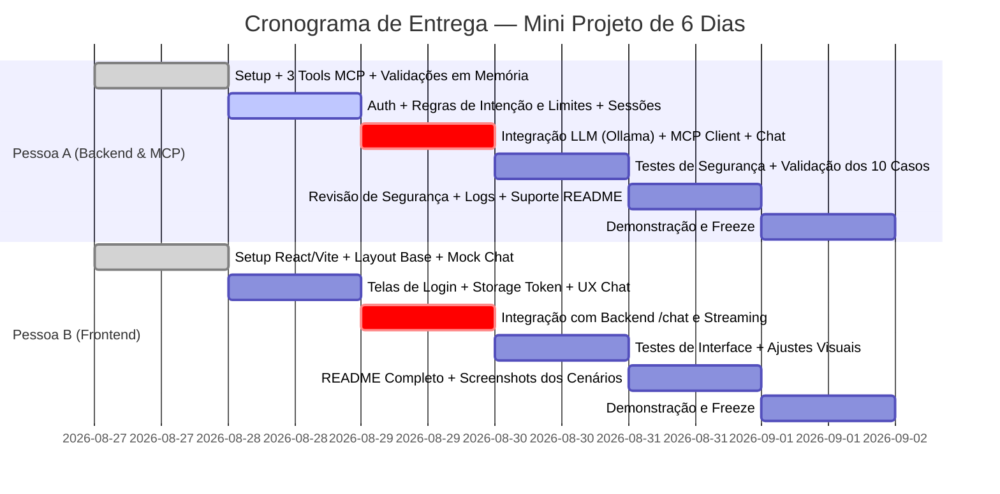

# Documento de Requisitos e Especificação Técnica Consolidada
## Desafio: Chatbot com Tools MCP de Pagamentos

> **Status:** Atualizado e Consolidado  
> **Fonte da Verdade:** [`docs/fase-1-bootcamp/desafio.md`](file:///c:/Users/kaycs/Dev/lab-chatbot-payments/docs/fase-1-bootcamp/desafio.md)  
> **Período do Projeto:** 27/08 a 01/09 (Sprint de 6 Dias)  
> **Equipe:** Pessoa A (Backend & MCP) e Pessoa B (Frontend & Integração)  

---

## 1. Visão Geral & Arquitetura do Sistema

O objetivo do projeto é construir um chatbot local onde o usuário faz login, conversa em linguagem natural com um agente LLM (executado localmente via Ollama) e realiza **compras seguras** através de ferramentas expostas via **Model Context Protocol (MCP)**.

```
┌────────────────────────────────────────────────────────┐
│                   FRONTEND (React + Vite)              │
│  - Tela de Login (Seleção de perfis de teste / Auth)   │
│  - Interface de Chat com Streaming em tempo real       │
│  - Visualização de Saldo/Limite, Tools e Comprovantes  │
└───────────────────────────┬────────────────────────────┘
                            │ HTTP REST & Streaming (Porta 3000)
                            ▼
┌────────────────────────────────────────────────────────┐
│                   BACKEND (Node.js + TS)               │
│  - Autenticação JWT (1h) e Perfis com limites em R$    │
│  - Histórico Completo da Conversa em Memória           │
│  - Orquestrador de Agente LLM (Ollama Client Local)    │
│  - MCP Client (Descoberta e Invocação de Tools)        │
└───────────────────────────┬────────────────────────────┘
                            │ MCP Streamable HTTP (Porta 3001)
                            ▼
┌────────────────────────────────────────────────────────┐
│                 MCP SERVER (`mcp-tools/`)              │
│  - `listar_catalogo`: Retorna produtos e estoque       │
│  - `registrar_intencao`: Gera intencao_id e valor total│
│  - `realizar_compra`: Valida e debita saldo            │
│  - Fonte da Verdade: Regras em memória determinísticas │
└────────────────────────────────────────────────────────┘
```

---

## 2. Princípio Fundamental: Backend como Fonte da Verdade

> [!IMPORTANT]
> **O LLM é probabilístico (sujeito a alucinações e tentativas de Jailbreak). O Backend/MCP é 100% determinístico.**
- O LLM **nunca** define preços, não aplica descontos por conta própria e não gera identificadores de transação.
- O parâmetro `valor` **não é enviado como argumento** na tool `realizar_compra`. O valor é recuperado diretamente da intenção previamente registrada e validada no backend.
- Tentativas do usuário ou do modelo de forjar `intencao_id` ou burlar o limite são barradas estritamente pelo backend.

---

## 3. Contratos Oficiais das 3 Tools MCP

### 3.1 Tool 1: `listar_catalogo`
Retorna a listagem de produtos disponíveis para compra com preços e estoque.

- **Parâmetros de Entrada (`inputSchema`):**
  ```json
  {
    "categoria": "string (opcional - filtro por categoria)"
  }
  ```

- **Retorno (`handler`):**
  ```ts
  {
    produtos: Array<{
      id: string;        // ex: "prod_001", "prod_002", "prod_003"
      nome: string;      // ex: "Fone Bluetooth", "Teclado Mecânico"
      preco: number;     // ex: 249.90
      moeda: "BRL";      // Moeda padrão
      estoque: number;   // ex: 12
      categoria?: string;
    }>
  }
  ```

---

### 3.2 Tool 2: `registrar_intencao`
Registra o interesse de compra de um produto e quantidade. **Nenhum dinheiro é movimentado nesta etapa.**

- **Parâmetros de Entrada (`inputSchema`):**
  ```json
  {
    "produto_id": "string (obrigatório - deve existir no catálogo)",
    "quantidade": "integer >= 1 (obrigatório)"
  }
  ```

- **Retorno com Sucesso (`handler`):**
  ```ts
  {
    intencao_id: string;    // ex: "int_a1b2c3" (gerado deterministicamente no backend)
    produto_id: string;
    quantidade: number;
    valor_total: number;    // calculado no backend (preco_unitario * quantidade)
    moeda: "BRL";
    status: "pendente";
    expira_em: string;      // ISO 8601 (Data atual + tempo de expiração configurado)
  }
  ```

---

### 3.3 Tool 3: `realizar_compra`
Executa o pagamento e débito de limite a partir de uma intenção de compra válida.

- **Parâmetros de Entrada (`inputSchema`):**
  ```json
  {
    "intencao_id": "string (obrigatório - gerado por registrar_intencao)",
    "metodo_pagamento": "'cartao' | 'pix' (obrigatório)"
  }
  ```

- **Retorno em Caso de Sucesso (`status: "aprovado"`):**
  ```ts
  {
    status: "aprovado";
    transacao_id: string;     // ex: "tx_9f8e7d"
    intencao_id: string;
    valor: number;            // valor real debitado
    metodo_pagamento: "cartao" | "pix";
    limite_restante: number;  // saldo remanescente do usuário após débito
    data: string;             // ISO 8601
  }
  ```

- **Retorno em Caso de Recusa / Erro (`status: "recusado"`):**
  ```ts
  {
    status: "recusado";
    erro: "INTENCAO_INVALIDA" | "INTENCAO_EXPIRADA" | "INTENCAO_JA_PAGA" | "LIMITE_EXCEDIDO" | "METODO_INVALIDO";
    mensagem: string;         // mensagem em português para o agente explicar ao usuário
  }
  ```

---

## 4. Matriz de Decisão e Regras de Validação

| Condição de Teste | Status | Código de Erro | Impacto no Saldo |
|---|---|---|---|
| `intencao_id` inexistente ou inventado pelo modelo | `recusado` | `INTENCAO_INVALIDA` | Inalterado |
| `intencao_id` pertencente a outro usuário | `recusado` | `INTENCAO_INVALIDA` | Inalterado |
| Intenção já utilizada em compra anterior | `recusado` | `INTENCAO_JA_PAGA` | Inalterado |
| Intenção expirada (`Date.now() > expira_em`) | `recusado` | `INTENCAO_EXPIRADA` | Inalterado |
| `valor_total` da intenção > `limite_disponivel` do usuário | `recusado` | `LIMITE_EXCEDIDO` | Inalterado |
| `metodo_pagamento` diferente de `"cartao"` ou `"pix"` | `recusado` | `METODO_INVALIDO` | Inalterado |
| Todas as validações aprovadas com sucesso | `aprovado` | *Nenhum* | `limite_disponivel -= valor_total` |

---

## 5. Estratégia de Autenticação & Perfis de Teste

Para validação imediata e auditável, o sistema adota autenticação baseada em perfis pré-configurados em memória:

| Perfil / Username | Senha | Nome do Usuário | Limite Inicial | Finalidade do Teste |
|---|---|---|---|---|
| `cliente_vip` | `123` | Maria Silva | **R$ 15.000,00** | Testar compras de múltiplos itens e alto valor |
| `cliente_padrao` | `123` | João Souza | **R$ 2.000,00** | Testar compras normais com PIX e Cartão |
| `cliente_sem_saldo` | `123` | Carlos Lima | **R$ 100,00** | Forçar e validar o erro `LIMITE_EXCEDIDO` |

---

## 6. Estrutura do Repositório & Gestão Git

### 6.1 Estrutura de Pastas
```
lab-chatbot-payments/
├── mcp-tools/                   # Servidor MCP independente (Porta 3001)
│   ├── src/
│   │   ├── types.ts             # Tipos do protocolo e contratos
│   │   ├── db/                  # Catálogo, Usuários e Intenções em memória
│   │   ├── tools/               # Implementação das 3 tools
│   │   ├── server.ts            # Servidor MCP via SDK oficial
│   │   └── test-tools.ts        # Script de testes unitários das tools
│   ├── package.json
│   └── tsconfig.json
├── backend/                     # API / Orquestrador LLM (Porta 3000)
│   ├── src/
│   │   ├── auth/                # Gerenciamento de login e limites
│   │   ├── mcp/                 # Cliente MCP (descoberta de tools)
│   │   ├── llm/                 # Integração Ollama (streaming e prompt)
│   │   └── server.ts            # Entrypoint HTTP/WS
│   ├── package.json
│   └── tsconfig.json
├── frontend/                    # Aplicação React + Vite (Pessoa B)
│   ├── src/
│   │   ├── components/          # Chat, Login, Cards de Produtos, Comprovantes
│   │   └── App.tsx
│   └── package.json
├── docs/                        # Documentação técnica e especificações
└── README.md                    # Guia completo de execução e screenshots
```

### 6.2 Estratégia de Branches & Commits

```
main (Produção / Entrega Final 01/09)
  ▲
  │ (Pull Request com review mútuo)
stage (Homologação & Integração Diária)
  ▲
  │ (Pull Request)
dev (Desenvolvimento ativo)
  ▲
  ├── feature/mcp-server-tools (Pessoa A)
  ├── feature/backend-auth (Pessoa A)
  ├── feature/frontend-chat (Pessoa B)
  └── feature/frontend-login (Pessoa B)
```

- **Padrão de Mensagens de Commit (Conventional Commits):**
  - `feat: adiciona tool listar_catalogo`
  - `feat: implementa validacao de limite no backend`
  - `fix: corrige validacao de expiracao da intencao`
  - `test: adiciona testes automatizados de intencao invalida`
  - `docs: atualiza instrucoes de execucao no README`

### 6.3 Política de Desenvolvimento: Commits Curtos, Atômicos e Auditáveis
> [!IMPORTANT]
> **Regra Mandatória de Versionamento:**
> - **A cada funcionalidade nova, pequena ou refatoração pontual, um commit isolado DEVE ser realizado imediatamente.**
> - Nunca acumular múltiplas tools, rotas ou lógicas distintas no mesmo commit.
> - O histórico do Git deve servir como trilha de auditoria limpa e clara do avanço do projeto.

### 6.4 Validação Obrigatória de Requisições & Endpoints com Postman
> [!IMPORTANT]
> **Regra de Validação de APIs / Requisições:**
> - **Toda nova rota HTTP, endpoint de MCP ou handler de WebSocket DEVE ser testado e validado no Postman (ou script de teste automatizado equivalente) ANTES de ser commitado.**
> - Devem ser validados tanto o cenário de sucesso (código 200/aprovado) quanto os cenários de erro esperados (ex: 400 Bad Request, 401 Unauthorized, erros de regra de negócio como `LIMITE_EXCEDIDO`).
> - Manter os exemplos de payloads salvos para facilitar a validação cruzada entre Pessoa A e Pessoa B.


---

## 7. Cronograma Operacional de 6 Dias (27/08 a 01/09)



### Detalhamento por Dia:

- **🟢 Dia 1 (27/08 - Quinta) — Fundação Operacional:**
  - *Pessoa A:* Criar `mcp-tools/`, instalar dependências (`@modelcontextprotocol/sdk`, `zod`, `express`, `tsx`, `dotenvx`), implementar as 3 tools e validar via `test-tools.ts`.
  - *Pessoa B:* Inicializar `frontend/` com Vite + React + TypeScript, montar layout de login e chat com dados mock.
  - *Meta:* Ambos com projetos rodando localmente.

- **🔵 Dia 2 (28/08 - Sexta) — Regras de Negócio e Sessão:**
  - *Pessoa A:* Criar autenticação, gerenciamento de limites por usuário, store de intenções com expiração no backend.
  - *Pessoa B:* Armazenamento do estado do usuário logado, proteção de rotas e interface de envio de mensagens.

- **🔥 Dia 3 (29/08 - Sábado) — DIA CRÍTICO: INTEGRAÇÃO GERAL:**
  - *Pessoa A:* Conectar Backend ao LLM (Ollama) e ao Servidor MCP via MCP Client, gerenciando o histórico completo.
  - *Pessoa B:* Integrar o chat do frontend com a API/WS do backend.
  - *Meta conjunta:* Executar o fluxo completo: `Login → "O que tem à venda?" → "Quero item 3" → "Pode pagar no PIX" → Compra Aprovada`.

- **🧪 Dia 4 (30/08 - Domingo) — DIA DE TESTES E QUEBRA DO SISTEMA:**
  - Executar a checklist de 10 testes de ponta a ponta (ver Seção 8).

- **🚀 Dia 5 (31/08 - Segunda) — FREEZE, README & SCREENSHOTS:**
  - Bloqueio de novas funcionalidades.
  - Capturar as 3 screenshots obrigatórias.
  - Escrever o `README.md` final com o passo a passo completo de execução.

- **🏁 Dia 6 (01/09 - Terça) — ENTREGA & APRESENTAÇÃO:**
  - Realizar teste de clone limpo (`git clone` em diretório limpo e execução do README).

---

## 8. Checklist dos 10 Testes Mandatórios

- [ ] **Teste 1 — Login Válido:** Credenciais corretas liberam acesso e carregam o saldo inicial.
- [ ] **Teste 2 — Acesso Não Autorizado:** Tentativa de acessar chat sem autenticação retorna `401 Unauthorized`.
- [ ] **Teste 3 — Catálogo de Produtos:** Chamada a `listar_catalogo` retorna lista correta com IDs, nomes, preços e estoque.
- [ ] **Teste 4 — Registro de Intenção:** `registrar_intencao` gera `intencao_id` válido, calcula o valor total correto no backend e define status `pendente`.
- [ ] **Teste 5 — Intenção Falsa/Forjada:** Envio de `intencao_id` inventado retorna erro `INTENCAO_INVALIDA`.
- [ ] **Teste 6 — Intenção de Outro Usuário:** Tentar pagar intenção criada por outro usuário retorna `INTENCAO_INVALIDA`.
- [ ] **Teste 7 — Pagamento Duplicado:** Tentar pagar uma intenção com status `paga` retorna `INTENCAO_JA_PAGA`.
- [ ] **Teste 8 — Intenção Expirada:** Tentar pagar intenção com prazo vencido retorna `INTENCAO_EXPIRADA`.
- [ ] **Teste 9 — Limite Excedido:** Usuário com saldo insuficiente (ex: `cliente_sem_saldo`) recebe recusa `LIMITE_EXCEDIDO` explicada pelo agente.
- [ ] **Teste 10 — Métodos de Pagamento:** Compra aprovada com sucesso tanto para `pix` quanto para `cartao`, com respectivo comprovante `tx_...` e atualização do saldo.

---

## 9. Screenshots Obrigatórias para a Entrega

1. **Screenshot 1 — Compra Aprovada:** Fluxo completo com catálogo, escolha do produto, confirmação de PIX/Cartão e retorno de comprovante (`tx_...`) com saldo atualizado.
2. **Screenshot 2 — Limite Excedido:** Tentativa de compra cujo valor ultrapassa o saldo disponível, exibindo a recusa `LIMITE_EXCEDIDO` tratada em linguagem natural.
3. **Screenshot 3 — Intenção Inválida:** Tentativa com `intencao_id` forjado pelo usuário/modelo, evidenciando o bloqueio pelo backend (`INTENCAO_INVALIDA`).

---

## 10. O que NÃO Deve Ser Feito (Anti-Patterns para o Prazo)

- ❌ Não usar Docker, Kubernetes ou orquestradores pesados.
- ❌ Não usar banco de dados externo (PostgreSQL, MySQL, Redis) — persistência em memória (`Map`/Arrays) atende 100% dos requisitos com máxima agilidade.
- ❌ Não implementar múltiplos agentes desnecessários ou frameworks excessivamente complexos.
- ❌ Não deixar a integração para o último dia.
